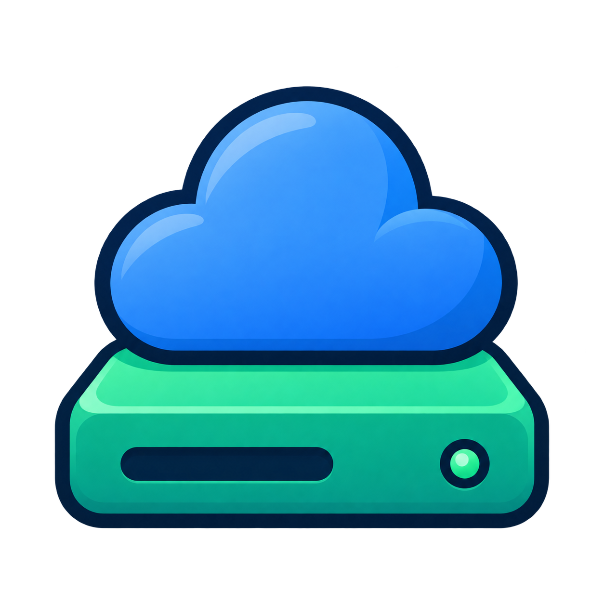
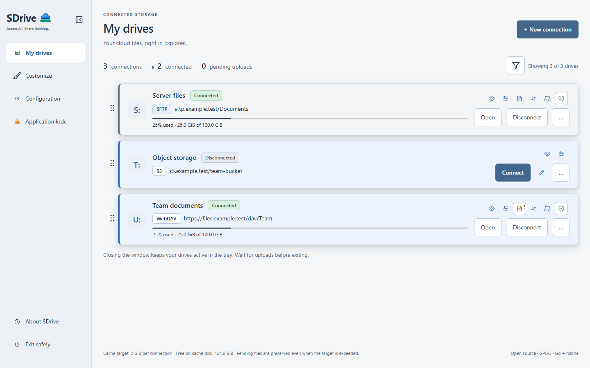

  

# SDrive

**Your cloud files, right in your file manager.**

SDrive brings cloud storage and remote servers into your everyday workflow. Connect them as local drives or folders, then open, edit and save files with the applications you already use, without downloading everything first.

Free and open source. Your storage, your accounts, one place to manage your connections.

[Features](#what-you-can-do) · [Get started](#get-started) · [User guide](docs/usage.md) · [Contribute](#help-improve-sdrive)

*The current interface with fictional demonstration data.*

## What you can do

- **Work from Explorer.** Connect storage as a drive letter or a local folder and use your usual applications.
- **Keep connections together.** Open, connect and disconnect your drives from one window or the system tray.
- **See what is happening.** Check connection status, storage space when available, pending uploads and recovery alerts.
- **Make it yours.** Choose light, dark or system appearance, change the interface language and personalize drive cards.
- **Choose how you connect.** Set read-only access, automatic connections and transfer limits when needed.
- **Reuse your setup.** Export connection definitions without credentials and sign in again after importing them on another computer.

Connection options include Google Drive, OneDrive, Dropbox, Nextcloud, SFTP, WebDAV, SMB and S3-compatible storage, among others. Explore the [connection options](docs/connectivity.md).

## Get started

1. Download a release from this repository's **Releases** page and install SDrive.
2. Open SDrive, choose **New connection** and select your service.
3. Sign in or enter your storage access details, choose a folder and select **Connect drive**.
4. Open the connected drive in your file manager and work with your usual applications.

See the [installation and user guide](docs/usage.md#install-and-connect) or [Linux guide](docs/linux.md) for installation details. The [sign-in setup guide](docs/oauth-setup.md) covers providers that require additional setup.

## Help improve SDrive

Help improve SDrive by reporting problems, sharing what works with your services, improving translations or contributing code and documentation.

See [how to contribute](docs/CONTRIBUTING.md) and the [provider testing checklist](docs/provider-validation.md#checklist-for-each-contribution).

## Learn more

- [User guide](docs/usage.md): installation, everyday use, preferences and updates.
- [Uploads, safe disconnection and recovery](docs/usage.md#use-your-drives).
- [Troubleshooting and diagnostics](docs/usage.md#collect-diagnostics-and-report-a-problem).
- [Security and privacy](docs/security.md): credential protection, local diagnostics and their limits. SDrive sends no telemetry.
- [Connection options](docs/connectivity.md) and [sign-in setup](docs/oauth-setup.md).
- [Development](docs/development.md) and [translations](docs/localization.md).

## License

SDrive is licensed under [GPL-3.0-only](LICENSE). Included components retain their own licenses; see [third-party notices](THIRD_PARTY_NOTICES.md).
